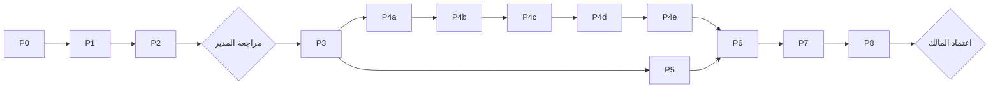

# خطة توحيد المفرّغات في مستودع `ytb`

> الهدف: يصبح سؤال «ما محتوى الشيخ الفلاني الذي لديه تفريغ؟» أمراً واحداً، وتُكتب أعمال التفريغ القادمة مباشرة في `ytb`.
> نوع الوثيقة: خطة فقط. لم يُنقل شيء ولم يُعدَّل أي مستودع مصدر. كل الأرقام أدناه قِيست بالقراءة فقط بتاريخ 2026-10-13.
> رؤوس المصادر المثبّتة: `hawshat@8a8b2812` · `des@d659a83` · `irth@e35ede5` · `ytb@ce20f96` (فيه README و.gitignore فقط).

---

## 0. حقائق مقيسة غيّرت التصميم (اقرأها أولاً)

| # | الحقيقة | أثرها على الخطة |
|---|---|---|
| F1 | ملفات المحاضرات النصية في المخازن الخمسة **8,612** ملفاً (hw-tr 1,705 · hw-ls 1,845 · irth 1,047 · des-mut 2,729 · des-dur 1,286). بعد استبعاد المكتبة (17) تبقى 8,595 | هذا هو عدد سجلات المحاسبة في التحقق |
| F2 | محتوى فريد بالبايت **5,150**؛ ونص فريد بعد تطبيع المسافات وحذف سطور الترويسة **3,998** | معظم التكرار نُسخ متطابقة؛ إزالة التكرار بالمحتوى قبل الرقم |
| F3 | بعد ربط السجلات بالـ vid **أو** بتطابق النص (union-find) ⇐ **3,938 درساً فريداً**: 3,670 لها معرّف يوتيوب و268 بلا معرّف | الحجم المتوقع لـ `ytb` ≈ 3,938 ملف نص |
| F4 | أكثر الملفات تحمل ترويسة في أول 3 أسطر: `الشيخ:` / `السلسلة: …list=PL…` / `الفيديو: https://youtu.be/<vid>`. معرّف الفيديو في الترويسة موجود في des-mut 2,412 · des-dur 1,138 · hw-tr 1,115 · hw-ls 36. ولم يقع **أي** تعارض بين vid الترويسة وvid المصادر الأخرى | **ترويسة النص هي المصدر الأول للهوية** |
| F5 | أرقام ملفات `des/durus/transcripts/<row>/N.txt` **ليست** أرقام الدروس: في عينة 100 ملف من 25 صفاً كانت `N = رقم mutalaa − 1` في 61 حالة، ومعكوسة الترتيب في صفوف (1003, 1005, 1006…)، مع تطابق النص 100%. المطابقة بالرقم أنتجت 771 «تعارضاً» زائفاً | **ممنوع** مطابقة des-dur بالرقم. المطابقة بالمحتوى ثم vid فقط |
| F6 | التعارض الحقيقي (درس واحد بنصّين مختلفين): **43 درساً** فقط (des-mut+des-dur 26 · hw-ls+irth 5 · الباقي متفرق) | قاعدة «الأحدث يفوز» تُطبَّق على 43 حالة وتحفظ الخاسر |
| F7 | 88 درساً نُسبت لأكثر من شيخ، و294 درساً ظهرت في أكثر من سلسلة (row) | تقرير مراجعة إلزامي قبل النسخ (البوابة M1) |
| F8 | `hawshat/irth-simulation`: 379 نصاً كلها **كلام عشوائي مُولَّد** («قال جهله هذا يتعلم من من جهله…»)، و0 من معرّفاتها الـ379 موجود في بيانات يوتيوب أو في irth | تُستبعد نهائياً |
| F9 | `hawshat/inbox`: 94 ملفاً كلها **align JSON فقط** (لا نصوص) لسلاسل البوطي (moarshaf 40 · naqed 48 · sassi 6) | تؤجَّل إلى طبقة المحاذاة الاختيارية (P9) |
| F10 | `hawshat/transcripts/maktaba`: 17 ملف `book-*.agy.txt` = كتب/متون (ألفية ابن مالك، مراقي السعود…) وبعضها ملوّث بنص «thought» من النموذج | تُستبعد كـ«كتب» (سؤال للمالك Q3) |
| F11 | 34 ملفاً تطابق نمط تلوّث بتفكير النموذج (`^thought`, `^Now let's`…) — مثل `alamri/hisam/hisam-01_AlAmri.txt`؛ 31 ملفاً جسمها أقل من 300 حرف (des-mut 25 · des-dur 3 · hw-tr 2 · hw-ls 1) | لا يفوز ملف ملوّث أو قصير إن وُجد بديل؛ وإلا يُنسخ بعلامة جودة |
| F12 | hawshat يملك نظام هوية مجمّداً للسلاسل: `row id = <sheikh-slug>--<key>` في `playlists/data/row_ids.json` (647 مفتاحاً بأنواع `k: m: s: t: p:`) + `muarchiv_slug_rowid.json` (623 alias) + `redirects.json` + ثوابت `TR_FOLD/TR_EXCLUDE/REDIRECTS` في `gen_stats.py` | نعيد استخدامه حرفياً بدل اختراع هوية جديدة |
| F13 | `des/mutalaa/data/manifest.json` (الحي) يختلف عن النسخة المثبّتة `hawshat/playlists/data/mut_manifest.json` (أول فرق عند البايت 216,711) مع نفس 999 صفاً و2,729 منجزاً | المرجع = نسخة des الحية؛ ويُسجَّل الفرق |
| F14 | أحجام: نصوص hw-ls 96M · hw-tr 62M · des-mut 89M · des-dur 40M. المحاذاة: hw-ls align 347M + sum 25M · irth align 136M (أكبر ملف 1.86MB) | الإصدار v1 = نصوص + بيانات وصفية فقط (سؤال Q2) |

**الدروس الفريدة لكل شيخ (union-find، مقيس):**

| slug | الشيخ | دروس | سلاسل |
|---|---|---:|---:|
| said-bouti | سعيد رمضان البوطي | 1,012 | 29 |
| adham-alasimi | أدهم العاسمي | 466 | 28 |
| habib-omar-ibn-hafiz | الحبيب عمر بن حفيظ | 443 | 11 |
| habib-ali-aljifri | الحبيب علي الجفري | 442 | 15 |
| ahmed-alsayed | أحمد السيد | 284 | 18 |
| bardouni-husaymi | محمد البردوني الحسيمي | 247 | 20 |
| ali-mahmoud-alomari | علي محمود العمري | 236 | 19 |
| ali-gomaa | علي جمعة | 234 | 11 |
| dhaker-alhashimi | ذاكر الهاشمي | 217 | 3 |
| fadhel-sulaiman | فاضل سليمان | 89 | 3 |
| mouloud-sariri | مولود السريري | 87 | 1 (+صفوف لم تُحل بعد) |
| saif-alasri | سيف العصري | 56 | 1 |
| aboubakr-almashhour | أبو بكر المشهور | 39 | 6 |
| muhammad-abdelwahid-hanbali | محمد عبد الواحد الحنبلي | 38 | 1 |
| ahmed-abdelmonem | أحمد عبد المنعم | 20 | 1 |
| hatem-alaouni | حاتم العوني | 19 | 3 |
| bensaib | بن سايب | 8 | 1 |
| (بلا شيخ) | — | 1 | — |

> عدد السلاسل هنا قبل حلّ 11 صفاً من mutalaa لا مفتاح لها في `row_ids` (`36, 37, 40, 112, 173, 344, 355, 743, 871, 985, 995`) — تُحل في P2 (القسم 3.4).

---

## 1. نموذج البيانات القانوني

### 1.1 هوية الدرس (lid) — بالترتيب
1. `yt:<vid>` — معرّف يوتيوب من 11 حرفاً. مصادره بالأولوية: ترويسة النص (`الفيديو:`) ← اسم الملف (`NA_<vid>` أو ذيل `_<vid>.txt` بشرط وجوده في `yt_titles.json`/`vid_plists.json`، نفس قاعدة `vid_of` في `gen_stats.py`) ← `playlists/data/read/<row>.json` (`file→vid`) ← `playlists/series/<slug>.json` (`n→video`) ← `irth/data/tube/videos.json` (`id→yt`) ← موضع القائمة: `(playlist من ترويسة/‏durus SERIES, n) → vid` عبر قلب `vid_plists.json`.
2. `rn:<row_id>:<n>` — إن لم يوجد vid وكان الصف ورقم الدرس معروفين (والرقم ليس من des-dur؛ F5).
3. `sn:<series-slug>:<n>` — لسلاسل hw-ls القديمة بلا row id.
4. `sha:<sha256[:16]>` — احتياط أخير (لا يُتوقع إلا لملف واحد بلا شيخ).

دمج الهويات: كل سجلّين يتشاركان vid **أو** بصمة النص المطبَّع (`nh`) هما درس واحد (union-find). لم يُرصد درس بأكثر من vid واحد (مقيس: 0).

**بصمة النص المطبَّع `nh`:** sha256 لنص UTF-8 بعد: حذف سطور الترويسة الثلاثة إن وُجدت في أول 400 حرف، ثم استبدال كل مسافات بيضاء متتالية بمسافة واحدة، ثم `strip`. (هي نفسها المستخدمة في القياس.)

### 1.2 الشيخ
- **اسم المجلد = slug لاتيني مجمَّد** من `hawshat/playlists/data/sheikhs.json` (29 شيخاً، مثل `said-bouti`). السبب: ثبات الروابط، لا مشاكل NFC/NFD ولا ترميز URL ولا اقتباس في أوامر عمّال Flash، والـslugs هي نفسها بادئة row ids.
- **القراءة بالعربية** تأتي من: `_sheikh.json` (الاسم الكامل/المعروض/الأسماء البديلة) و`README.md` مولَّد في كل مجلد شيخ (يعرضه GitHub تلقائياً)، و`COVERAGE.md` في الجذر.
- جدول الإسناد (يُنسخ إلى `ytb/_meta/sheikh_map.json` في P1):
  - irth `speakers[0]`: `bouti→said-bouti, alamri→ali-mahmoud-alomari, alsayed→ahmed-alsayed, fadel→fadhel-sulaiman, alasri→saif-alasri, abdelwahid→muhammad-abdelwahid-hanbali, abdelmonem→ahmed-abdelmonem, aouni→hatem-alaouni`.
  - أسماء manifest/ترويسة/durus: مطابقة بعد التطبيع (حذف التشكيل، أ/إ/آ→ا، ى→ي، ة→ه — دالة `norm` في `gen_stats.py`) مع `name`/`name_display`/`aliases`. حالات ثابتة: `البردوني→bardouni-husaymi`، `الحسيمي_تجربة` (الصف 985 «المنهج المنتخب») ⇐ `bardouni-husaymi` لأن hawshat ينسبه كذلك (`transcripts/bardouni/mut-985`)، `محمد متولي الشعراوي→sharawi`.
  - سطر `الشيخ:` لا يُعتدّ به إلا إذا تبعه سطر `السلسلة:` أو `الفيديو:` (رُصدت 181+ حالة يكون فيها «الشيخ: بسم الله…» تسمية متحدث لا ترويسة).
- تُنشأ مجلدات للشيوخ الذين لديهم ≥1 درس فقط (17)؛ ويظهر الـ29 كلهم في `catalog.json` (بعدد 0 لمن لا تفريغ له).

### 1.3 السلسلة
- **الهوية = row id القانوني من hawshat**: `canon(row)` = اتّباع `redirects.json` ثم `REDIRECTS` و`TR_FOLD` من `gen_stats.py` (`bardouni/ajhuri→bardouni-husaymi--10`, `jifri/insaniyya→habib-ali-aljifri--117`).
- مفاتيح البحث حسب المخزن: hw-tr `t:<dir>-<row>` · hw-ls اسم المجلد إن احتوى `--` وإلا `slug_to_rowid[<dir>]` أو `s:<dir>` · des-mut/des-dur `k:<row>` أو `m:<row>` · irth عبر vid من المخازن الأخرى (كل 1,047 vid في irth موجودة في مخزن آخر — مقيس).
- **اسم المجلد = الجزء بعد `--`** من row id: `said-bouti/379/`، `said-bouti/bouti-khutab-2010/`، `aboubakr-almashhour/mashhour-azma/`. فريد داخل الشيخ لأن row ids فريدة ومجمّدة.
- الصفوف بلا row id (الـ11 أعلاه + durus `37`): يُصنع `<sheikh>--<mutId>` بنفس اصطلاح `gen_stats` (الشيخ من manifest الحي، و`37` من `des/durus/data.js` SERIES ⇐ `mouloud-sariri`، «شرح المنهج المنتخب»). تُسجَّل في `_meta/row_map.json` كإضافات `ytb-only`.
- مجلدات `TR_EXCLUDE` في hw-tr (`bouti/tafsir 184, bouti/hikam 114, bouti/rihab 48, bouti/tawba 42` + `sariri/manhaj-muntakhab`, `maktaba/book-um_baraheen_d1`) لا تُنشئ سلسلة؛ ملفاتها تُلحق بالسلسلة التي يحددها vid/النص، وما لا يُلحق يذهب إلى `<sheikh>/_unsorted/`.
- العنوان العربي للسلسلة: manifest `name` ← بطاقة `series/<slug>.json` `title` ← `transcripts/index.json` `title`.

### 1.4 رقم الدرس n
بالأولوية: `read/<row>.json` `n` ← بطاقة السلسلة `n` حسب vid ← موضع vid في playlist الصف (`vid_plists.json`) ← بادئة `NNN_` في des-mut ← اسم ملف hw-ls ← بادئة رقمية في hw-tr. **لا يُؤخذ من des-dur أبداً.** يُحفظ مصدره في `n_src`. تعارض n داخل سلسلة: يُحتفظ بالحقيقي ويُعطى المكرر `max+1` (نفس قاعدة `rows_from_files`). لا «تصحيح» للترتيب (انظر `bahith-order-mismatch.json`، 104 صفوف).

### 1.5 شجرة `ytb` وأسماء الملفات
```
ytb/
  README.md                       (موجود؛ يُوسَّع بجدول مختصر)
  catalog.json                    (مولَّد)
  COVERAGE.md                     (مولَّد)
  <sheikh-slug>/
    _sheikh.json                  (مصدر يدوي)
    _index.json                   (مولَّد)
    README.md                     (مولَّد)
    <row-key>/
      _series.json                (مصدر يدوي)
      _index.json                 (مولَّد)
      README.md                   (مولَّد)
      <stem>.txt                  (النص الفائز، بايتات المصدر كما هي)
      <stem>.meta.json            (هوية ومصادر الدرس)
      _variants/<stem>.<store>.txt  (النص الخاسر عند التعارض فقط)
    _unsorted/                    (دروس معروفة الشيخ بلا سلسلة)
  _unattributed/<store>-<row>/    (بلا شيخ؛ المتوقع ملف واحد)
  _inbox/                         (منطقة إسقاط للتفريغ الجديد؛ القسم 6)
  _meta/  inventory.jsonl  plan.jsonl  ledger.jsonl  conflicts.jsonl
          sheikh_map.json  row_map.json  source_heads.json  excluded.json
  tools/  inventory.py resolve.py scaffold.py apply.py build_index.py verify.py ask.py add_lesson.py ingest_inbox.py
  DEDUPE_REPORT.md                (مولَّد في P2)
```
- `<stem>` = `NNN_<vid>` (مثل `001_AwLGGCLZxdo`) إن وُجد vid؛ وإلا `NNN` ؛ وإن لم يُعرف n: `x_<sha12>`. `NNN` ثلاثة أرقام (أربعة إن تجاوزت السلسلة 999). أسماء الملفات ASCII فقط ⇒ لا تصادم ولا مشكلة تطبيع.
- **الثبات عبر التشغيلات**: `_meta/plan.jsonl` هو سجل `lid → path`. أي تشغيل لاحق لا يعيد تسمية مسار موجود أبداً؛ يضيف فقط. تغيير n لاحقاً يُحدَّث داخل `meta.json` و`_index.json` لا في اسم الملف.
- الامتدادات `.align.json` و`.sum.json` محجوزة لنفس `<stem>` في P9.

### 1.6 مخطط `<stem>.meta.json`
```json
{"v":1,"lid":"yt:AwLGGCLZxdo","vid":"AwLGGCLZxdo","sheikh":"said-bouti",
 "row_id":"said-bouti--345","n":1,"n_src":"read|card|plpos|mutfile|lsfile|trfile|none",
 "title":"…","title_src":"yt_titles|card|read|manifest|filename",
 "sha256":"<winner bytes>","nh":"<normalized body>","chars":13074,
 "quality":"ok|short|contaminated",
 "winner":{"store":"des-mut","path":"mutalaa/data/txt/345/001_….txt","commit_ts":1759... ,"head":"d659a83"},
 "sources":[{"store":"des-dur","path":"durus/transcripts/345/0.txt","sha256":"…","rel":"identical|same-body|variant"}],
 "variants":["_variants/001_AwLGGCLZxdo.irth.txt"],
 "also_in":["said-bouti--bouti-mashahid"]}
```
رموز المخازن: `hw-tr`=`hawshat/transcripts` · `hw-ls`=`hawshat/playlists/lessons` · `irth`=`irth/content/tube` · `des-mut`=`des/mutalaa/data/txt` · `des-dur`=`des/durus/transcripts`.

---

## 2. محرك الإجابة

### 2.1 الملفات (كلها مولَّدة بـ `tools/build_index.py` من الشجرة وحدها؛ لا يحرَّر يدوياً)
**`<sheikh>/<row-key>/_index.json`**
```json
{"v":1,"row_id":"said-bouti--379","sheikh":"said-bouti","title":"تاريخ التشريع الإسلامي",
 "playlists":["PL…"],"declared_total":38,"transcribed":38,"coverage":1.0,
 "lessons":[{"n":1,"vid":"…","title":"…","file":"001_….txt","chars":13074,"sha256":"…","quality":"ok","variants":0}]}
```
**`<sheikh>/_index.json`**
```json
{"v":1,"slug":"said-bouti","name":"محمد سعيد رمضان البوطي","name_display":"سعيد رمضان البوطي","aliases":["البوطي"],
 "totals":{"series":29,"lessons":1012,"chars":0,"with_vid":0,"unsorted":0},
 "series":[{"key":"379","row_id":"said-bouti--379","title":"…","dir":"379/","transcribed":38,"declared_total":38,"coverage":1.0}]}
```
**`catalog.json`**
```json
{"v":1,"source_heads":{"hawshat":"8a8b2812","des":"d659a83","irth":"e35ede5"},
 "totals":{"sheikhs_with_content":17,"series":0,"lessons":0,"chars":0},
 "sheikhs":[{"slug":"said-bouti","name":"…","name_display":"…","aliases":["البوطي"],"series":29,"lessons":1012,"path":"said-bouti/"}],
 "aliases_index":{"البوطي":"said-bouti","بوطي":"said-bouti"}}
```
(`aliases_index` مفاتيحه مطبَّعة بدالة `norm`.)
**`COVERAGE.md`**: جدول شيوخ (الاسم · السلاسل · الدروس · رابط)، ثم لكل شيخ جدول سلاسل (العنوان العربي · مفرَّغ/معلَن · نسبة · رابط المجلد)، ثم ذيل «مستبعد» من `_meta/excluded.json`.
**`README.md` لكل شيخ/سلسلة**: نفس الجداول مقصورة على النطاق، حتى يقرأ GitHub العربية داخل مجلدات اسمها لاتيني.

### 2.2 قواعد `build_index.py`
- المدخل: `_sheikh.json`, `_series.json`, `*.meta.json` فقط. المخرجات حتمية: مفاتيح مرتبة، `ensure_ascii=False`, `indent=1`, لا طوابع زمنية (الطابع الوحيد `source_heads`).
- `--check`: يعيد التوليد في الذاكرة ويخرج برمز 1 إن اختلف عن القرص (يُستخدم في التحقق وCI لاحقاً).
- يفشل إن: وُجد `.txt` بلا `.meta.json` أو العكس؛ sha256 في meta ≠ الملف؛ stem مكرر؛ مجلد سلسلة بلا `_series.json`.

### 2.3 الأمر الواحد
```bash
python3 tools/ask.py البوطي          # الاسم/اللقب/slug؛ يطبع: الشيخ، عدد السلاسل والدروس، جدول السلاسل
python3 tools/ask.py البوطي --json   # نفس الشيء JSON
jq '.sheikhs[]|select(.slug=="said-bouti")' catalog.json   # بديل بلا Python
```

---

## 3. قواعد إزالة التكرار والتعارض

1. **تطابق البايتات (sha256)** ⇒ ملف واحد؛ البقية `rel=identical` في `sources`، وفي الدفتر `decision=duplicate`.
2. **تطابق النص المطبَّع (nh) مع اختلاف البايتات** (ترويسة/مسافات) ⇒ درس واحد، `rel=same-body`؛ يُنسخ الفائز وحده.
3. **نفس lid ونصوص مختلفة (43 حالة)** ⇒ يُختار فائز بهذا الترتيب:
   1. يُقصى `quality=contaminated` (نمط F11) ثم `short` (جسم < 300 حرف) إن وُجد بديل سليم.
   2. **الأحدث**: أحدث وقت commit لملف المصدر في git (لا mtime؛ كل ملفات الاستنساخ تحمل وقت 2026-10-13 10:57). يُحسب مرة واحدة لكل مستودع: `git -C <repo> log --format='C %ct' --name-only -- <subdir>` وأول ظهور للمسار = أحدث commit.
   3. تعادل ⇒ الأطول جسماً ⇒ ثم ترتيب المخازن `des-mut > des-dur > hw-tr > hw-ls > irth`.
   - الخاسر يُحفظ في `_variants/<stem>.<store>.txt` ويُسجَّل في `conflicts.jsonl`: `{lid, winner{store,path,sha,ts,chars}, losers[...], reason, jaccard_4gram}`.
4. **المطابقة بين المخازن** تتم بالـ vid والنص فقط. الرقم وحده لا يربط مخزنين (F5). الصف يربط فقط لتحديد المجلد.
5. **درس في أكثر من سلسلة (294)**: الفائز = row بعد `canon`؛ إن بقي أكثر من واحد ⇒ صف manifest الرقمي (mutalaa) يتقدم على صفوف `s:`/`t:` القديمة ⇒ ثم الصف الذي فيه موضع playlist للـ vid. الباقي في `also_in`. لا يُكرَّر الملف.
6. **درس منسوب لأكثر من شيخ (88)**: الشيخ = بادئة row id الفائز؛ وإن لم يوجد ⇒ ترويسة النص ⇒ irth. كل الـ88 تُدرج في `DEDUPE_REPORT.md` قسم «إسناد متنازع» بقرار آلي مقترح.
7. **تكرار داخل المخزن نفسه** (مقيس: hw-tr 162 · des-mut 21 · hw-ls 4) يُعامل بالقاعدة 1/2.

### 3.4 التقرير (`DEDUPE_REPORT.md`) — أقسام إلزامية
أعداد لكل مخزن (ملفات/فريد/مكرر/خاسر/مستبعد) · الدروس لكل شيخ وسلسلة · جدول الـ43 تعارضاً · الـ88 إسناداً · الـ294 تعدد صفوف · الصفوف الـ12 المصنوعة · الدروس بلا vid (268) مع مصدر n · قائمة الملوّث والقصير · الفرق بين manifest الحي والمثبّت (F13).

---

## 4. المراحل (موجزات عمّال قابلة للتنفيذ)

**قواعد عامة لكل عامل:**
- يعمل داخل `/root/workspace/ytb` على الفرع المحلي `consolidate/v1`؛ ممنوع `git push`، ممنوع أي كتابة/حذف/`git checkout`/`git pull` في `hawshat` و`irth` و`des`.
- Python 3.14 المتوفر، مكتبة قياسية فقط. كل كتابة ذرّية (`.tmp` ثم `os.replace`).
- ممنوع طباعة متغيرات البيئة أو `git config --list` أو أي رابط يحمل token.
- قبل وبعد كل مرحلة: `git -C <repo> rev-parse HEAD` و`git -C <repo> status --porcelain` للمصادر الثلاثة يجب أن يطابقا `_meta/source_heads.json`.
- كل مرحلة تنتهي بـ commit محلي واحد: `ytb: P<k> <وصف>`.
- إن انحرف أي عدد مقيس في هذه الخطة بأكثر من 2% ⇒ توقف واكتب السبب في `_meta/STOP.md` ولا تكمل.

### P0 — التهيئة (≈ دقائق)
- **المدخلات:** المستودعات الأربعة.
- **الأوامر:** `git -C ytb switch -c consolidate/v1`؛ إنشاء `tools/ _meta/ _inbox/`؛ كتابة `_meta/source_heads.json` بـ `{repo: {head, porcelain:[…]}}`؛ إضافة `/_work/` إلى `.gitignore`.
- **القبول:** الرؤوس = `8a8b2812 / d659a83 / e35ede5`، وحالة `status --porcelain` تطابق الخط الأساسي المقيس قبل التنفيذ (موجود مسبقاً وليس من هذه الخطة: hawshat ` D AGENTS.md` + `?? .hermes/`، des `?? .hermes/`، irth نظيف). تُحفظ هذه الأسطر حرفياً في `source_heads.json` ويُقارن بها لاحقاً. **الإنجاز:** commit «P0 scaffold».

### P1 — الجرد الشامل `tools/inventory.py` (حوسبة < 2 دقيقة؛ القياس على كل الملفات استغرق ≈ 40 ث)
- **المدخلات:** المخازن الخمسة + `hawshat/transcripts/maktaba` + `hawshat/irth-simulation/content/tube` + `hawshat/inbox` + `hw-ls *.align.json/*.sum.json/*.wwords.json` + `irth align/summary/questions` + **أعداد فقط** للمستبعدات `des/{shami,nusus,kutub,manzuma,jadid2}`.
- **ما يحسبه لكل ملف نصي:** `store, path, bytes, sha256, nh, chars_body, header{sheikh,playlist,vid}, fname_vid, read_vid, card_vid, irth_vid, row_key_raw, row_id(canon), n_candidates{…}, commit_ts, quality`.
- **مخرجات:** `_meta/inventory.jsonl` (سطر/ملف)، `_meta/row_map.json` (دمج `row_ids.json` + `alias_keys` + `slug_to_rowid` + `redirects.json` + ثوابت gen_stats)، `_meta/sheikh_map.json`، `_meta/excluded.json` (`{path_prefix, reason, file_count}`).
- **القبول:** نصوص المحاضرات: hw-tr 1,705 · hw-ls 1,845 · irth 1,047 · des-mut 2,729 · des-dur 1,286 (=8,612) + maktaba 17 + irth-sim 379 + inbox 94 align. لا سجل بلا sha256. لا قراءة لمحتوى المستبعدات.
- **الإنجاز:** commit «P1 inventory».

### P2 — الحل وإزالة التكرار `tools/resolve.py` (< 2 دقيقة)
- **المدخلات:** `inventory.jsonl`, `row_map.json`, `sheikh_map.json`, manifest الحي، `durus/data.js` (SERIES)، `series/*.json`, `read/*.json`, `vid_plists.json`, `yt_titles.json`.
- **الخطوات:** union-find (vid ∪ nh) ⇒ lid ⇒ شيخ ⇒ row ⇒ n ⇒ فائز وفق القسم 3 ⇒ stem ⇒ مسار الهدف.
- **مخرجات:** `_meta/plan.jsonl` (سطر/درس: `lid, target, winner_record, sources[], variants[], also_in[]`)، `_meta/conflicts.jsonl`، `DEDUPE_REPORT.md`.
- **القبول:** دروس 3,938 (±2%) · بلا vid 268 · تعارض نصي 43 · إسناد متنازع 88 · تعدد صفوف 294 · كل سجل من الـ8,595 مذكور في درس واحد بالضبط · لا مساران متطابقان في الخطة.
- **البوابة M1 (مدير، لا مالك):** مراجعة الـ43 والـ88 في التقرير؛ يمكنه كتابة `_meta/overrides.json` (`{lid: {sheikh|row_id|winner}}`) وإعادة تشغيل P2. **لا تُبدأ P3 قبل M1.**

### P3 — الهيكل `tools/scaffold.py` (دقائق)
- ينشئ مجلدات الشيوخ (17 متوقعة) و`_sheikh.json` من `sheikhs.json`، ومجلدات السلاسل و`_series.json` (`{v,row_id,key,sheikh,title,playlists[],declared_total,source_rows{mut,series_slug,tr_dir}}`؛ `declared_total` = manifest `total` ⇐ وإلا `pl_len.json` ⇐ وإلا «غير محدد» `null`).
- **القبول:** كل `target` في plan له مجلد أب فيه `_series.json`؛ لا مجلد فارغ من الدروس. **الإنجاز:** commit.

### P4 — النسخ `tools/apply.py --store <code>` (بالترتيب المطلوب)
| الخطوة | المخزن | ملفات المصدر | ملاحظات |
|---|---|---:|---|
| P4a | hw-tr | 1,705 | يتجاوز maktaba؛ ملفات TR_EXCLUDE تُنسخ فقط إن فازت |
| P4b | hw-ls | 1,845 | `NNN.txt` فقط في v1 |
| P4c | irth | 1,047 | `transcript.txt` فقط في v1 |
| P4d | des-mut | 2,729 | — |
| P4e | des-dur | 1,286 | يُتوقع أن يفوز في عدد قليل (15 درساً لا توجد إلا فيه) |
- **سلوك كل تشغيل:** لكل درس فائزه من هذا المخزن: انسخ البايتات كما هي إلى `target`، اكتب `meta.json`؛ للخاسرين من هذا المخزن اكتب `_variants/`. إن وُجد الهدف بنفس sha ⇒ تخطَّ؛ بـ sha مختلف ⇒ **لا تكتب**، سجّل في `_meta/STOP.md` وتوقف. يكتب سطراً لكل سجل مصدر في `_meta/ledger.jsonl`: `{store,path,sha256,decision: copied|duplicate|variant|excluded|deferred, ytb_path, lid}`.
- **التوازي:** الأهداف متباعدة (لكل درس فائز واحد) فيمكن تشغيل P4a–P4e متوازية؛ الموصى به تسلسلياً مع commit لكل خطوة لسهولة المراجعة. الحوسبة لكل خطوة < 1 دقيقة؛ زمن جلسة العامل غير محدد.
- **القبول:** عدد `copied` الكلي = عدد الدروس في plan؛ مجموع `copied+duplicate+variant` لكل مخزن = ملفاته.

### P5 — قرارات البقايا (يمكن موازاتها مع P4)
- `irth-simulation` (379) ⇒ `excluded: synthetic` في الدفتر.
- `inbox` (94 align) ⇒ `deferred: align-only` (تُستخدم في P9 إن اعتُمدت؛ هويتها من رابط الفيديو داخل الكلمات الأولى).
- `maktaba` (17) ⇒ `excluded: book` حتى قرار Q3.
- `des/{shami,nusus,kutub,manzuma,jadid2}` ⇒ `excluded: book-corpus` (أعداد فقط، بلا مسارات أفراد).
- align/sum/questions/wwords ⇒ `deferred: layer-v2`.
- **القبول:** لا سجل في الجرد بلا قرار.

### P6 — توليد الفهارس `tools/build_index.py` + `tools/ask.py`
- **القبول:** `build_index.py --check` يخرج 0؛ مجموع `lessons` في `catalog.json` = عدد ملفات `<stem>.txt` = عدد أسطر plan؛ `ask.py البوطي` يطبع 1,012 درساً (±2%) في 29 سلسلة (±2 بعد حل الصفوف).

### P7 — التحقق `tools/verify.py` (القسم 5)

### P8 — حزمة الاعتماد (محلي فقط)
- commit نهائي على `consolidate/v1`، و`_meta/APPROVAL.md`: الأعداد النهائية، حجم المستودع (`du -sh --exclude=.git`)، أكبر 10 ملفات، ملخص التعارضات، أوامر الدفع المقترحة **دون تنفيذها**.



---

## 5. التحقق (إثبات عدم الفقد)

1. **محاسبة المصادر:** كل سجل في `inventory.jsonl` له سطر واحد في `ledger.jsonl` بقرار من {copied, duplicate, variant, excluded, deferred}. لـ copied: الملف موجود و sha256 مطابق. لـ duplicate: `ytb_path` موجود ونصه المطبَّع (nh) أو بايتاته = المصدر. لـ variant: الملف موجود في `_variants/` بنفس sha. **أي سجل يتيم ⇒ فشل.**
2. **مطابقة الأعداد:** لكل مخزن `copied+duplicate+variant` = (1,705 · 1,845 · 1,047 · 2,729 · 1,286)؛ دروس ytb = 3,938 ±2%؛ لكل شيخ مقابل جدول القسم 0 (انحراف > 2% يحتاج تفسيراً في التقرير).
3. **عينة محتوى:** 40 درساً عشوائياً ببذرة ثابتة (`seed=20261013`)، 8 من كل مخزن فائز: (أ) sha ملف ytb = sha مصدر الفائز، (ب) vid في meta = vid الترويسة إن وُجدت، (ج) أول 200 حرف بعد الترويسة متطابقة، (د) عنوان meta يحوي كلمة واحدة على الأقل مشتركة مع `yt_titles.json[vid]`. + كل الـ43 تعارضاً: وجود الفائز والخاسر.
4. **سلامة الاستبعاد:** لا ملف في ytb جاء من `irth-simulation`, `maktaba`, `des/{shami,nusus,kutub,manzuma,jadid2}` (فحص `winner.path` و`sources[].path`).
5. **سلامة المصادر:** HEAD و`status --porcelain` للمستودعات الثلاثة = `source_heads.json`.
6. **الفهارس:** `build_index.py --check` = 0؛ كل `file` في `_index.json` موجود؛ ترميز UTF-8 صالح لكل `.txt`؛ لا ملف > 50MB.
- المخرج: `_meta/VERIFY.md` بجدول PASS/FAIL لكل بند. **تعريف الإنجاز للمشروع: كل البنود PASS.**

---

## 6. ملاءمة خط التفريغ المستقبلي

**صيغة الإسقاط:** عامل agy يكتب ملفاً نصياً واحداً يبدأ بالترويسة الموجودة أصلاً في 2,412 ملفاً من des-mut:
```
الشيخ: <الاسم>
السلسلة: https://www.youtube.com/playlist?list=<PL…>
الفيديو: https://youtu.be/<vid>

<النص>
```
**المسار أ (مباشر):** `python3 tools/add_lesson.py --file out.txt [--sheikh <slug|اسم>] [--series <row-key>] [--n N] [--title …]`
- يقرأ الترويسة لملء ما لم يُمرَّر؛ الشيخ عبر `aliases_index`؛ السلسلة عبر `row_map.json` (`p:<playlist>` ⇒ row id)؛ n عبر `vid_plists.json` ثم `read/`.
- يرفض: UTF-8 غير صالح، جسم < 300 حرف، نمط تلوّث F11، vid موجود بنفس nh (مكرر ⇒ يطبع المسار الموجود).
- vid موجود بنص مختلف ⇒ قاعدة «الأحدث يفوز»: الجديد يصبح `<stem>.txt` والقديم يُنقل إلى `_variants/` ويُسجَّل في `conflicts.jsonl`.
- يكتب `<stem>.txt` + `meta.json` (`winner.store="agy"`)، ينشئ `_series.json` إن كانت السلسلة جديدة، ثم يشغّل `build_index.py` ويطبع `git status --short`. لا commit ولا push تلقائي.

**المسار ب (دفعات):** إسقاط الملفات في `ytb/_inbox/` ثم `python3 tools/ingest_inbox.py` ⇒ يطبق المسار أ على كل ملف؛ ما لم يُحل (شيخ/سلسلة) يبقى في `_inbox/` مع `_inbox/_rejects.jsonl` (السبب).

**قراءة التطبيقات:** سلسلة ثابتة بلا خادم: `catalog.json` ⇒ `<sheikh>/_index.json` ⇒ `<row-key>/_index.json` ⇒ `<stem>.txt`، عبر `https://raw.githubusercontent.com/medmrf-10/ytb/main/…` أو GitHub Pages (`https://medmrf-10.github.io/ytb/…`) إن فُعّلت. لاحقاً (مهمة منفصلة تحتاج اعتماداً لأنها تمس مصدراً): توجيه `base` في `hawshat/playlists/data/read/<row>.json` إلى `…/ytb/<sheikh>/<row-key>/` بدل des، وتعديل `gen_stats.py` ليقرأ `ytb/catalog.json`.

---

## 7. مخاطر وأسئلة للمالك

- **Q1** أسماء المجلدات: slug لاتيني (الموصى به) مع README عربي، أم أسماء عربية مباشرة؟
- **Q2** هل تدخل طبقة المحاذاة/الملخصات (≈ 508MB مقيسة: 347+25+136) في v1 أم تؤجَّل إلى P9؟
- **Q3** ملفات `maktaba` الـ17 (كتب، وبعضها ملوّث بتفكير النموذج): استبعاد نهائي؟
- **Q4** تعريف «الأحدث» = وقت commit في git لملف المصدر — مقبول؟
- **Q5** هل تُحفظ النصوص الخاسرة (43) داخل `ytb/_variants` علناً أم في الدفتر فقط؟
- **Q6** المستودع عام: هل نشر نصوص محاضرات الشيوخ علناً مأذون فيه لكل الـ17؟
- **Q7** بعد الاعتماد، هل يصبح `ytb` المصدر الوحيد للتفريغ (فتتوقف الكتابة في des/hawshat)؟
- **R1** خطر: أرقام des-dur المضللة (F5) — أي سكربت مستقبلي يطابق بالرقم سيُفسد النسب؛ البند 4 من القسم 3 يمنعه.

---

## 8. ما يعتمده المالك وبأي ترتيب

1. **قبل التنفيذ:** إجابات Q1، Q2، Q3، Q4، Q5 (تحدد سلوك P2–P5). بلا إجابة ⇒ تُطبق الافتراضات الموصى بها: slug · نصوص فقط · استبعاد maktaba · git commit time · حفظ المتغيرات في `_variants`.
2. **بعد P2/M1:** الاطلاع على `DEDUPE_REPORT.md` (الـ43 والـ88) — اعتماد اختياري.
3. **بعد P8:** اعتماد `_meta/VERIFY.md` (كل البنود PASS) و`_meta/APPROVAL.md`.
4. **الدفع:** اعتماد صريح لدفع `consolidate/v1` إلى `origin` (فرع أولاً ثم دمج إلى `main`). لا شيء يُدفع قبل هذا.
5. **Q6** قبل جعل المحتوى مرئياً (المستودع عام أصلاً، فالدفع = نشر).
6. **اختياري لاحقاً:** تفعيل GitHub Pages لـ `ytb`؛ ثم مهمة منفصلة لتوجيه hawshat/des إلى ytb (Q7)؛ ثم P9 (المحاذاة) إن وُوفق على Q2.
